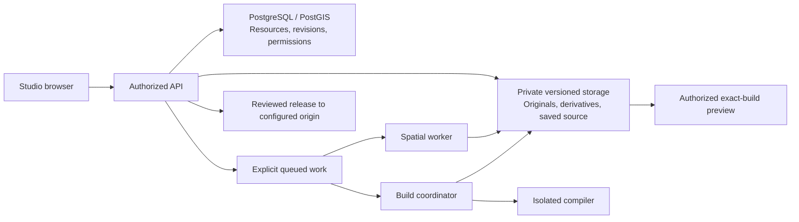

# How OpenGeo Studio fits together

*An open workspace for geospatial analysis and publishing.*

OpenGeo Studio connects spatial inputs, reusable maps and analytical publications.
The community edition includes the application and its supporting services. This
guide explains the boundaries to help contributors find the right component;
the [roadmap](../ROADMAP.md) records release maturity.

For a working local environment, start with the
[Linux development guide](community-development.md). For an account-owned
installation, use the [AWS guide](community-aws.md). Our
[deployment examples](community-deployments.md) distinguish the public website,
authenticated Studio and anonymous demo.

## Runtime boundaries

| Component | Responsibility | Why it is separate |
| --- | --- | --- |
| [Studio](../app/src/) | Browser Catalog inspection, map composition and publication editing. | A temporary inspection can stay separate from a saved Project and from paid processing. |
| [API](../services/api/README.md) | Authenticate requests, check resource authority and coordinate durable operations. | Browser state and metadata never establish permission by themselves. |
| [PostgreSQL/PostGIS](../database/README.md) | Resource identities, immutable revisions, spatial data, access rules and job state. | Data and history survive frontend or worker replacement. |
| [GIS worker](../services/worker/README.md) | Validate uploaded bytes and create bounded spatial derivatives or rendered outputs. | Native parsers and queued work receive limited execution and storage authority. |
| [Publication compiler](../services/observable-builder/README.md) | Compile an exact staged source revision into checksummed output. | Authored code runs without the coordinator's database or AWS credentials. |
| [Build coordinator](../services/observable-coordinator/README.md) | Lease jobs, stage exact inputs, enforce compiler isolation and collect verified output. | Trusted storage and authorization checks stay outside authored code. |
| [Preview bootstrap](../services/observable-preview/README.md) | Exchange a one-time capability for access to an exact private build path. | A private preview stays separate from public publication. |
| [Infrastructure](../infrastructure/README.md) | Connect identity, API, storage, queues and optional workers in an operator's account. | Deployment configuration stays outside shared resource records. |

The local runner substitutes synthetic identities and local object/queue
transports for development. The AWS profile uses Cognito, Lambda/API Gateway,
Aurora/PostGIS, encrypted versioned S3 storage and optional queued workers.
Local evidence does not establish production authentication, encryption or
operational recovery.

## Where work is retained

| State or representation | Authoritative home | Relationship to other work |
| --- | --- | --- |
| Browser draft and session renderer settings | Browser/session state within the selected application | A demo draft is separate from account-backed records. Provider tokens stay outside shared Projects. |
| Layer/Style identities, Project configuration, metadata, rights and revisions | PostgreSQL/PostGIS through authorized API contracts | The database records resource/version relationships, permissions and transactional activity. |
| Original files and GIS working/display derivatives | Configured private versioned object storage, with exact references in the database | Checksums and lineage connect derivatives to retained inputs; normalization does not replace originals. |
| Publication source and admitted build inputs | Saved source revisions and configured private application storage | The coordinator stages exact authorized inputs for a selected build. |
| Compiled output and retained Artifact editions | Verified immutable build/output storage with persistent records | A retained build can be inspected or reused without rebuilding it from changed inputs. |
| Public release | The independently configured web origin and its delivery resources | Release records connect the reviewed source/build to the selected address and activation. |

The [data lifecycle example](community-data-lifecycle.md) follows one small input
through these representations. [Publication destinations](community-publication-destinations.md)
explains origin selection, source synchronization, updates and reviewed rollback.

## Design choices and their tradeoffs

| Choice | Practical benefit and tradeoff | Preserve when extending it |
| --- | --- | --- |
| Independent resource identities | Reuse Layers and Styles across Projects; references and versions require explicit management. | Identity, history, ownership and current resource authority. |
| References and preserved copies | Keep authoritative data remote or retain a specific input; availability and preservation are different commitments. | Custody, exact bytes where preserved, source terms and declared capture scope. |
| Renderer adapters | Use a shared composition across compatible engines; rendering profiles and provider terms differ. | Canonical configuration, compatibility refusal, disposal and session-only tokens. See [renderers](community-renderers.md). |
| Isolated compilation | Run authored analytical code without trusted storage credentials; staging and supported dependencies are deliberately constrained. | Input admission, sandbox boundaries, byte verification and separate publication authority. |
| Immutable inputs and revision checks | Reopen, compare and reuse saved work; edits create new versions rather than rewriting evidence. | Exact source/build identity, concurrency checks and transactional history/activity. |
| Deliberate worker activation | Bound heavy processing and idle infrastructure; setup, queueing and startup can add latency. | Named jobs, quotas, cancellation, leases, cleanup and explicit operator configuration. |

API routes and versioned exchange schemas are the interfaces between these
components. Source adapters need operation-specific contracts, not just a new
format name. The [interoperability guide](community-interoperability.md) links
representative implementations and focused checks.

## Resources and compatibility

Catalog inventories known resources. A Layer has persistent identity independent
of a Project; inspecting it opens a temporary map without saving a composition.
A Project combines Layers, reusable Styles and map configuration. Saving a map
records a version that can be reopened and updated with a revision check.

An Artifact is compiled output with its own editions. A Publication is authored
narrative or analytical work that can use Layers directly or embed Artifacts.
Collections hold ordered Project and Publication references; collection membership
does not grant access to those resources. Geographic tags describe places without
establishing ownership or access.

The schema retains legacy names for compatibility. In particular, `app.projects`
also serves as an access container, while `app.maps` stores compositions. A row in
the former does not by itself prove that a user has deliberately created a product
Project. Preserve identities, history and working references when changing an API
or migrating records; do not infer a resource's product role from a table name.

## API entry points

The [FastAPI application](../services/api/src/opengeo_api/app.py) assembles the
route modules. Start with [authentication](../services/api/src/opengeo_api/auth_routes.py),
[workspace operations](../services/api/src/opengeo_api/workspace_routes.py),
[Catalog operations](../services/api/src/opengeo_api/catalog_routes.py) and
[resource operations](../services/api/src/opengeo_api/resource_routes.py).
Route declarations and their focused tests define request/response contracts;
this overview is not a complete API specification.

`GET /health/live` tests the process, while `GET /health/ready` tests database
availability. `GET /auth/session` verifies a Cognito access token and resolves
current application membership. Account selection never grants membership.
Tenant operations establish verified organization/user context inside the same
database transaction as permission checks and domain reads or writes. PostgreSQL
row-level security complements those checks; the API must not use a migration
owner or a role that bypasses it.

Versioned updates use revision checks, and related history/activity writes commit
together. Managed uploads bind verified immutable object versions before queuing
processing. Reads and previews must not silently copy remote data or start work.
Optional adapters can remain unconfigured; an available route or retained source
definition does not prove that an execution path is enabled in an installation.

## Metadata and source custody

Preserve producer metadata, normalized fields, curated interpretation and inferred
claims separately, including missing knowledge. The
[metadata adapters](../services/api/src/opengeo_api/metadata_adapters.py) and
[metadata routes](../services/api/src/opengeo_api/metadata_routes.py) expose
operation-specific mappings; they do not establish blanket standards conformance.
Metadata history must survive application rollback without rewriting source facts.

Referenced, hosted, cached, mirrored and derived inputs have different custody.
Retaining a service URL preserves a reference; an exact archived object preserves
bytes. Managed copies and derivatives retain immutable source/version/checksum
facts. Rights and redistribution terms remain specific to the distribution;
download access does not by itself authorize publication.

Source support is also operation-specific. Registration, metadata import,
interactive display, editing and preservation are separate capabilities. For
example, STAC metadata import does not imply execution of every STAC asset or
extension, and a live ArcGIS MapServer display reference does not establish an
archived source. See [external-source validation](../services/api/src/opengeo_api/external_sources.py)
and [STAC handling](../services/api/src/opengeo_api/stac.py).

## Processing and deployment

The worker consumes commands for already registered uploads or explicit jobs.
Its database role calls fixed lease/claim/completion functions rather than
receiving general table authority. It verifies exact input versions and bytes,
runs bounded native tools, and commits output facts and job state together.
Ordinary Catalog or map reads do not dispatch conversion or reclamation jobs.
Source originals remain distinct from normalized working data and display output.

The [worker README](../services/worker/README.md) describes input limits, parser
isolation, derivative types and image checks. The
[AWS guide](community-aws.md) covers the supported installation profile, explicit
worker selection, permissions, costs, backups and upgrades. Image and dependency
security checks remain necessary for a release; passing source tests does not
approve a container image or authorize a cloud deployment.

## Publication builds and private previews

The coordinator stages the exact source revision and admitted data bindings,
checks current authority, and sends storage-free inputs to the compiler. The
compiler validates paths, sizes and checksums, uses its pinned dependency cache,
and produces a sealed output tree inside an isolated runtime. The coordinator
rechecks bytes and input authority before completing the job. Build success and
private preview access do not publish anything.

Archived data inputs and retained Artifacts have separate admission limits and
authorization checks. Source-upload access does not grant access to those inputs.
Publication additionally requires appropriate redistribution authority for the
exact inputs. Unsupported content should remain preserved with a disclosed
conversion limit rather than being silently dropped or treated as executable.

Optional incremental page caching reuses output only within matching source,
compiler and presentation scope. It is separate from the ordinary compile path;
the component notes distinguish prepared local adapters from activated production
caching. A cache receipt or an old hosted compiler pin is not a community release
acceptance result.

## Artifacts and release recovery

Artifacts give compiled outputs stable identities and immutable numbered editions.
Registering an edition can reuse an existing verified output without copying data
or rerunning a render. Publication builds can consume exact retained Artifact bytes
without rebuilding their source map. Current source permission is rechecked under
the build's live lease; input access and output publication access stay separate.
See the [Artifact API implementation](../services/api/src/opengeo_api/project_artifacts.py)
and [publication input checks](../services/api/src/opengeo_api/publication_artifact_inputs.py).

Release creation keys allow an exact-input retry to return its original active
identity after authorization is rechecked. They do not authorize duplicate
transfers, broader access or replaying a different request. Preserve completed
output, prior costs and immutable history across interruption or application
rollback. See [Artifact sharing and release handling](../services/api/src/opengeo_api/artifact_shares.py).

## Acceptance and next steps

Component READMEs retain technical notes and dated evidence from development and
the maintainers' hosted deployment. These explain boundaries and implementation
history; their image hashes, private checks and deployed status do not establish
acceptance of a fresh community installation.

The [development guide](community-development.md) records the bounded local
Project save–restart–reopen journey and its limits. Independent fresh installation,
the complete native publication journey and supported production self-hosting
remain open in the [community roadmap](../ROADMAP.md). Improve those
workflows before expanding unused integrations, and report local checks,
connected acceptance and deployment separately.
