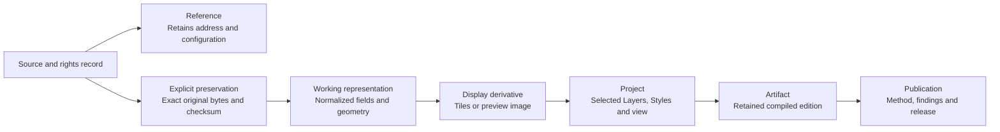

# Keep the evidence behind a map

A useful map needs more than a source URL. Another practitioner should be able
to identify the inputs, understand the method, distinguish interpretation from
producer facts and determine which outputs can be shared. OpenGeo Studio keeps
those decisions attached to independently identified resources.

Start with the [five synthetic community facilities](../app/src/data/sample-public-facilities.geojson)
and their [source and rights record](../app/src/data/public-demo-catalog.json).
The input is CC0-1.0 demonstration data. Its names, coordinates and verification
dates are fictional. The [browser exercise](community-examples.md#try-it-community-facilities)
can reproduce the counts below without an account.

## One input, several representations



The browser exercise covers inspection and styling. Managed uploads,
derivatives and saved Publications require connected Studio; see the
[capability matrix](community-capabilities.md) for current support.

| Decision | What to do with the facilities example | What the record means |
| --- | --- | --- |
| Discover and inspect | Read the source/rights record and inspect the five features. | A known source and its metadata; inspection creates neither an account Project nor a preserved remote copy. |
| Reference or preserve | A remote service can remain a reference. An explicit managed upload or supported capture retains bytes. | A URL/configuration retains a connection; an immutable original plus checksum records the exact preserved input. Capture scope and redistribution rights still matter. |
| Select an edition | Record the repository commit and original-file checksum before using this sample. In connected Studio, select the relevant governed dataset version. | A version pin identifies the input. A metadata date or a file name alone does not establish acquisition time or accuracy. |
| Create a working representation | A supported upload may normalize a vector to GeoParquet/CRS84 or expose governed features. | A derivative with its own identity and lineage. The original is retained; normalization can change representation and must disclose applicable losses. |
| Prepare a display | Use an appropriate preview, PMTiles derivative or map rendering. | A display representation, not necessarily the original geometry, attributes or analytical pixels. |
| Compose and explain | Save a Project with selected Layers and Styles; state the count method in a Publication. | Independently versioned composition and explanation. A compiled Artifact can be reused without silently rerunning the analysis. |
| Review and publish | Review included input versions, terms and audience, then select an approved destination. | A confirmed release links source, build and public address. Preview access and an address reservation do not establish public delivery. |

For this input, counting records gives **five facilities**, of which **four have
`public_access: true`**. That supports a statement about the supplied attributes.
It does not establish service capacity, coverage, opening hours, disability
access or the number of people served. The fictional `last_verified` values
provide no real verification evidence.

Record the source revision and exact bytes locally:

```bash
git rev-parse HEAD
sha256sum app/src/data/sample-public-facilities.geojson
```

The [exercise](community-examples.md) shows how to inspect and count the features.
Use a configured Studio installation to preserve a managed copy or create a derivative.

## Facts, interpretation and permission

| Kind of knowledge | Example | What to preserve |
| --- | --- | --- |
| Source-provided | The fixture reports `public_access: true`. | Original value and source/version. |
| Normalized | A field is mapped into a common metadata vocabulary. | Original field, mapping and known losses. |
| Curated | A practitioner explains that the sample is fictional and unsuitable for service planning. | Author, explanation and supporting evidence. |
| Inferred | A tool proposes a category or interpretation. | Method, time, agent, confidence where available and explicit uncertainty. An inference does not overwrite a producer fact. |

Software licensing, dataset rights, provider terms, application permissions and
resource ownership answer different questions. The software's Apache-2.0 terms
do not license a third-party survey. A public map service may permit viewing
without permitting a preserved copy or redistribution. Access to a restricted
input does not authorize publishing its bytes in a report. Review terms per
distribution and leave unknown rights explicit.

An Account supplies membership context. A Layer, Project or Publication retains
its own authority and history. Collections and geographic tags organize resources
without granting access to them. A public explanation can cite a restricted input
while clearly stating what readers can and cannot inspect.

## Where contributors can extend this path

The [preservation helpers](../app/src/lib/dataPreservation.js),
[source capability catalog](../app/src/lib/sourceCapabilityCatalog.js),
[knowledge implementation](../services/api/src/opengeo_api/resource_knowledge.py)
and [dataset processing](../services/worker/src/opengeo_worker/processor.py)
own different parts of the lifecycle. Read the relevant source and focused
checks before adding a format or operation. Preserve original identities and
bytes, current access checks, provenance, explicit conversion limits and
upstream credit.

The [architecture guide](community-architecture.md) explains storage and security
boundaries; [publication destinations](community-publication-destinations.md)
explains how a reviewed build reaches a configured web address and how updates
or rollback retain its evidence.
