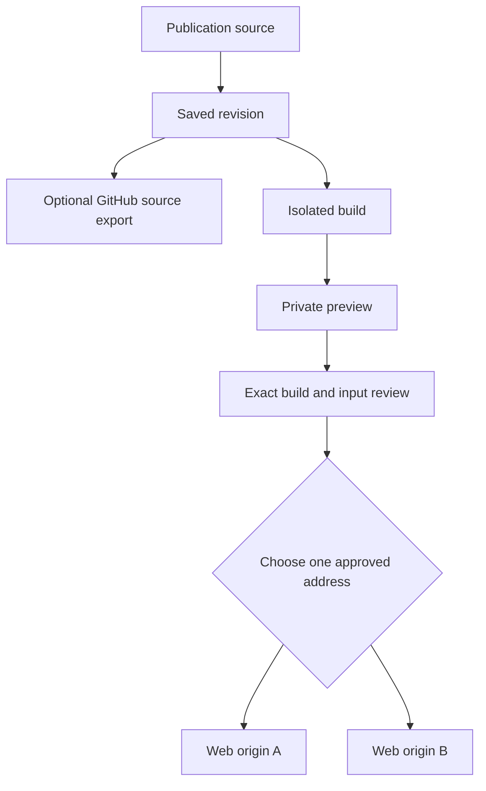

# Publish analytical work to a chosen destination

Use OpenGeo Studio to prepare an analytical Publication, review a saved build and
release it to an approved web address. Publications combine narrative, charts,
methods and maps, retaining links to their source revisions and data inputs.
Each has its own identity and versions, and can use Layers or retained Project
Artifacts.

The community source includes the publishing components described here. The
complete native build, preview and public-release workflow still needs independent
installation testing; see the [release notes](../RELEASE_NOTES.md).
The [local runtime readiness review](api/native-publication-readiness.md) identifies
the missing connections for saved-source builds and authorized private previews.

## From saved source to one public address



Each review selects one saved build and one reserved destination. The branches
represent a choice; approval does not broadcast to every configured origin.
Saving a draft, exporting source and compiling a preview are separate actions.

Studio's [release controls](../app/src/components/FrameworkPublications.js) let
the user select a successful saved build, inspect linked files and map releases,
prepare a review, open its private preview and explicitly approve public delivery.
The review retains build identity, output checksums, destination, previous release
and expected generation. Read permission alone does not authorize publication;
included files and Artifacts need their applicable publication authority and
distribution review.

## Approved origins and reserved paths

An operator configures public origin records and the hosting resources they are
allowed to use. Delegation can let authorized publication users reserve a slug
beneath an approved prefix, within the configured reservation limit. Root paths
and new hosting prefixes need administrator configuration. Reserving an address
does not create a bucket, configure DNS or make content public.

The [destination form](../app/src/components/PublicationDestinationForm.js)
receives approved origin IDs and public URL prefixes. Users do not supply AWS
authority. The [API](../services/api/src/opengeo_api/observable_source_routes.py)
checks reservation and review requests; the
[delegated-address migration](../database/migrations/0103_delegated_publication_addresses.sql)
defines tenant, path, permission and retry constraints.

An operator with two hosting destinations could configure
`OPEN_GEO_FRAMEWORK_PUBLICATION_DESTINATIONS`:

```json
[
  {
    "hostname": "research.example.org",
    "bucket": "example-research-publications",
    "distribution_id": "EEXAMPLERESEARCH",
    "origin_id": "research-publications"
  },
  {
    "hostname": "projects.example.org",
    "bucket": "example-project-publications",
    "distribution_id": "EEXAMPLEPROJECTS",
    "origin_id": "project-publications"
  }
]
```

These example names are placeholders. The operator must separately
configure corresponding database origin records, approved prefixes, IAM authority
and working S3/CloudFront resources. The allowlist must retain the configured
legacy bucket/distribution pair for existing queued jobs. The
[router](../services/api/src/opengeo_api/publication_destinations.py) accepts a
bounded list and matches the complete hostname/bucket/distribution/origin tuple;
cross-pairing resources from two records is rejected. Studio and private-preview
hosts are protected from use as public destinations.

Suppose origin A has ID `00000000-0000-4000-8000-000000000001` and delegates
`/reports/`. An infrastructure screening Publication could reserve
`https://research.example.org/reports/screening/` with this request body to
`POST /projects/{project_id}/source-projects/{source_project_id}/publications/destinations`:

```json
{
  "reservation_id": "00000000-0000-4000-8000-000000000011",
  "origin_id": "00000000-0000-4000-8000-000000000001",
  "slug": "screening",
  "acknowledgment": "reserve-address-without-publishing"
}
```

A different survey-methods Publication could use origin B's ID
`00000000-0000-4000-8000-000000000002`, a new `reservation_id` and slug
`survey-methods`. With B's delegated `/studies/` prefix, its address would be
`https://projects.example.org/studies/survey-methods/`. Each Publication then
selects its own saved build and returned mount ID for review. The controller
resolves A to the research resources and B to the project resources.
The [destination checks](../services/api/tests/test_publication_destinations.py)
and [Studio checks](../app/test/framework-publications.test.mjs) exercise these
selection, scope and uncertain-response boundaries locally.

## Delivery, updates and rollback

The cloud adapter delivers through **S3 and CloudFront**. Other web hosts need a
separate adapter. The
[planner](../services/api/src/opengeo_api/framework_publisher.py) builds a fresh
`releases/framework-{review_id}` tree from the exact approved output. It preserves
verified root and sibling files outside the selected publication path, rejects
path collisions and binds copied files to object versions or ETags, sizes,
checksums and delivery metadata.

The [AWS adapter](../services/api/src/opengeo_api/framework_publication_aws.py)
copies and verifies output before conditionally changing the selected CloudFront
origin path. It supports reviewed S3 website origins and private S3 origins with
an exact Origin Access Control identity. Distribution fingerprints and `If-Match`
checks stop concurrent configuration changes from being overwritten. The adapter
waits for deployment and the release-specific cache invalidation, rechecks the
pointer and returns a receipt. Current activation uses one wildcard invalidation
per release identity; replay reconciles that identity.

The [queue controller](../services/api/src/opengeo_api/framework_publication_controller.py)
claims a durable review, rechecks authority, checkpoints bounded file batches and
resumes the same plan after interrupted copies or an uncertain activation response.
A conflict becomes `needs_attention`; it does not silently adopt another build
or destination. Representative
[planner/recovery checks](../services/api/tests/test_framework_publisher.py) and
[adapter checks](../services/api/tests/test_framework_publication_aws.py) cover
sibling preservation, changed authority, conditional writes and lost responses.

For an update, save a new revision, build it, review that exact output and select
the existing address. Source revision, compiler image, build result, input
distribution approval and output-tree checksum stay attached to the release.
For rollback, Studio prepares a **new review of a retained earlier build**,
including its linked files and map releases. Preview and approval are required
again. The earlier build is reused rather than compiled from today's inputs;
planning preserves other publications' current files. Expected generation and
public-pointer checks still apply.

## Optional GitHub export and trusted builds

[GitHub source synchronization](../services/api/src/opengeo_api/github_source_sync.py)
exports one explicitly selected saved revision to an authorized private
repository. Revision-specific refs, commit/tree identities, a source manifest
checksum and a retained receipt support retry and reconciliation. Authority is
checked before reading/exporting and again before advertising success. Saving a
draft does not automatically export it. See the
[GitHub adapter](../services/api/src/opengeo_api/github_publications.py) and
[source synchronization checks](../services/api/tests/test_github_source_sync.py).

That optional source archive is separate from trusted build dispatch. The
[build controller](../services/api/src/opengeo_api/github_build_controller.py)
supports canonical OpenGeo Studio source mode without requiring a user
source-export connection. An operator-configured GitHub build provider still
requires its own trusted workflow and scoped GitHub App configuration. The
controller retains dispatch/run identities and logs and reconciles an uncertain
dispatch before retrying. GitHub Pages delivery is unsupported.

The [compiler](../services/observable-builder/README.md) receives pre-staged,
checksummed inputs without application credentials. Its deployment must enforce
isolation and no runtime network access. A trusted coordinator verifies the
outputs; publication requires separate approval. Private previews and download
tickets use scoped, time-limited access.

## Versioned formats and portable outputs

The checksummed `opengeo.publication.json` record uses schema
`opengeo.publication.1`, with `format` and `entry` fields. The
[format selector](../services/observable-builder/src/publication-format.mjs)
rejects mismatched entries and unknown fields; the
[Studio starters](../app/src/lib/publicationDrafts.js) retain this selection with
the source. The compiler supports the following profiles, covered by its
[format checks](../services/observable-builder/test/builder.test.mjs):

- **Framework:** Markdown pages compile with the pinned Framework 1.13.4 cache
  into HTML and assets. The dependency graph must be present in the sealed image;
  source lockfiles do not authorize arbitrary package installation.
- **HTML and map:** Static HTML/assets are packaged as exact admitted bytes.
  The map starter supports inserting a portable map viewer. This format label
  does not make every remote map source self-contained or publicly distributable.
- **Observable Notebook:** Declared Notebook markup compiles to a standalone
  `index.html` with the pinned Notebook Kit 2.5.6 runtime and referenced attachments.
  Checks verify retained notices and exclusion of unused private source; cells
  are not executed on the build host. General remote module compatibility remains
  bounded by the admitted compiler profile.
- **Jupyter:** Native nbformat 4 source stays intact while supported saved outputs
  and images render into HTML pages. No Python/IPython kernel executes. Checks
  cover output sanitization, omitted private files and route collisions; unsupported
  widgets or output types need their original environment.
- **Framework single HTML:** The separate `single-html` output representation
  localizes a bounded compiled dependency graph into one verified HTML file with
  a localization manifest. The
  [localization checks](../services/observable-builder/test/framework-standalone.test.mjs)
  reject missing authored modules, changed bytes and unsupported external assets.
  The full dependency-graph test requires its saved acceptance artifact.

Ordinary compiler output is bounded to 32 MiB. The explicit `archive-96m` profile
admits selected exact archive or localized outputs with pinned inputs and a size
acknowledgment; it does not raise every compiler limit or authorize arbitrary
large files. Downloading retained source or output preserves an artifact; making
it publicly reachable still requires the appropriate delivery and rights review.

## Publication status

| State | What it means | Next step |
| --- | --- | --- |
| Address reserved | The API has assigned an approved origin and publication path. | Select the build to deliver. Reservation alone serves no content. |
| Build dispatched | A durable job has an accepted dispatch/run identity. | Wait for the build result. Source export is a separate operation. |
| Build succeeded / private preview | Verified output is available through an authorized, temporary preview. | Review that exact output and its input rights. |
| Reviewed / queued | The selected build, destination, checksums and input approvals are recorded. | Wait for delivery; queue acceptance does not make the release public. |
| Delivery completed | The release receipt confirms CloudFront deployment, cache invalidation and the public pointer. | Check the published address; retain the build for updates or rollback. |

## Spatial services and contributor boundaries

Publishing a spatial resource as a service is a separate workflow from deploying
an analytical website. Studio's WMS controls deliberately publish eligible
resources under project-scoped service identities and support explicit withdrawal.
The [WMS implementation](../services/api/src/opengeo_api/wms.py) admits selected
GetCapabilities/GetMap operations for versions 1.3.0 and 1.1.1, bounded layers,
CRS and SVG/PNG delivery; it is not an unrestricted service implementation.
[Service tests](../services/api/tests/test_wms.py) and
[Studio publication tests](../app/test/project-wms-publications.test.mjs) describe
those boundaries. The [capability guide](community-capabilities.md) distinguishes
other service operations and consuming upstream services from publishing our own.

A contributor adding a hosting adapter should start with the planner's
`PublicationStorage` and `PublicationEdge` protocols and the destination router.
Preserve tenant and publication authority, exact input/output identity, verified
copy semantics, reserved-path ownership, conditional activation and durable
recovery. Extend focused fixture checks around these contracts before a live
release. These internal interfaces are not a maintained deployment-plugin API.
