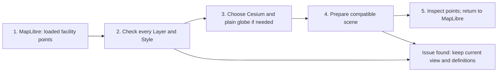

# Choose a map renderer

OpenGeo Studio keeps a Project's Layers, Styles and camera separate from the
engine that displays them. You can switch a compatible map to another renderer
and keep the same Project and source data. MapLibre is the default; Mapbox and
Cesium are optional, with the limits described below. Selecting a globe
projection alone does not switch engines.

See the [capability matrix](community-capabilities.md) for supported operations
and the [release notes](../RELEASE_NOTES.md) for installation and acceptance
limits.

## What each engine does

| Engine | Available route | Requirements and limits |
| --- | --- | --- |
| MapLibre GL JS 6.4.1 | Default browser map, with source, style and camera handling and the application's archive protocols. | Supported source and style profiles still apply; default does not mean every GIS format or tool is supported. |
| Mapbox GL JS 3.30.0 | Optional GL adapter selected in **Rendering engine**. | Supply a public `pk.` token for the workspace session. Provider account, terms and possible charges apply. Compatibility checks can refuse archive protocols, composite opacity, KML presentation, unsupported fonts and active tools. |
| CesiumJS 1.145.0 | Separate native globe scene for admitted, loaded WGS84 vector Layers. | Supports navigation, picking, Layer visibility and ordering, selected styles and pinned labels. Compatible public raster backgrounds can transfer; otherwise explicitly choose a plain globe. Switch back for unmapped editing and styling tools. This route does not establish general terrain or 3D Tiles support. |
| OpenLayers 10.10.0 | Geometry, projection and exchange utilities; independent interoperability/reference checks. | It is not a selectable Studio renderer. `spatialInterchange.js` uses WKT, WKB and WFS utilities; Cesium label anchors use OpenLayers polygon/projection utilities. |

The [renderer controls](../app/src/components/RendererPanel.js) explain the
active engine and show compatibility issues before a switch. The default
[MapLibre renderer](../app/src/lib/mapRenderer.js) and
[MapLibre adapter](../app/src/lib/maplibreAdapter.js) supply the browser map.
Optional SDKs load when selected, through the
[Mapbox](../app/src/lib/mapboxLoader.js) and
[Cesium](../app/src/lib/cesiumLoader.js) loaders. Release assets must match the [Mapbox](../app/src/lib/mapboxRuntime.js)
and [Cesium](../app/src/lib/cesiumRuntime.js) pins.

## What a switch preserves

The canonical Project definition and persistent Layer/Style identities stay in
the shared model. Adapters make a presentation snapshot; they must not delete
unsupported definitions to make a candidate display. Hidden Layers are checked,
because making a Layer visible later must not reveal silently lost content.

For GL engines, the application prepares a candidate surface with the current
camera, style and images, waits for readiness, then replaces the current map.
Cancellation, errors and timeout dispose the candidate and leave the current
view usable. SDK ownership and disposal are explicit in the
[GL adapter](../app/src/lib/glRendererAdapter.js) and
[switch preparation](../app/src/lib/rendererSwitch.js).

Mapbox receives its public token only through per-map options. The
[credential session](../app/src/lib/mapboxSession.js) keeps it in memory, outside
Projects, drafts, browser storage, exports and API payloads. Switch away from
Mapbox before forgetting its token, because the active SDK still owns its map
options. MapLibre sky presentation is retained separately and restored on return;
the engines can render the same admitted data differently.

Cesium uses a [scene adapter](../app/src/lib/cesiumAdapter.js) and
[Workbench bridge](../app/src/lib/cesiumWorkbench.js). The bridge retains the GL style for switching back
and maps supported camera, visibility, order and save operations explicitly.

## A small compatible switch

Use the small point Layer in the [community facilities exercise](community-examples.md#try-it-community-facilities).
For a minimal candidate, use a loaded WGS84 point Layer with a simple circle
style, disable labels and temporary overlays, and finish drawing or measurement.
The [workflow guide](community-workflow.md) explains how Layers and Projects fit
into the wider analysis and publishing process.

1. Open the small synthetic input and resolve its simple point style in MapLibre.
2. Open **Rendering engine** and read the per-Layer compatibility report.
3. Choose **Use Cesium**. If the background is unmapped, explicitly consent to
   a plain globe; the original basemap remains available on return.
4. After preparation succeeds, inspect a point and toggle its Layer visibility.
5. Choose **Use MapLibre** to return to the retained map presentation.

The representative
[Cesium renderer check](../app/test/cesium-renderer.test.mjs) admits a simple
styled polygon while retaining its identity and original picking index. The
[Workbench check](../app/test/cesium-workbench.test.mjs) covers hidden vectors and
refusal of incomplete live sources. These source checks do not replace browser
acceptance on your installation. A Mapbox evaluation also requires your public
token.

## Understand a refusal

Mapbox rejects MapLibre-specific archive protocols, multi-sprite styles and
unmapped presentation features. Cesium requires loaded 2D WGS84 vector geometry
and supported style passes; limits include 50,000 features, 500,000 coordinate
positions and bounded label/style work. Live feature requests, archive sources,
KML Places, active edits, terrain/scene tools and temporary view overlays can
block a switch. Unsupported basemaps require the explicit plain-globe choice.
The checks include hidden content and provide reasons instead of dropping it.

| Extension boundary | Source and representative existing check |
| --- | --- |
| GL SDK ownership and cleanup | [Adapter](../app/src/lib/glRendererAdapter.js); [two SDKs and protocol ownership](../app/test/gl-renderer-adapter.test.mjs). |
| Readiness, cancellation and sky translation | [Switch preparation](../app/src/lib/rendererSwitch.js); [candidate failure, cancellation and preservation](../app/test/renderer-switch.test.mjs). |
| Mapbox admission and credential lifetime | [Adapter](../app/src/lib/mapboxAdapter.js); [token isolation, hidden blockers and SDK loading](../app/test/mapbox-renderer.test.mjs). |
| Cesium geometry, styles and backgrounds | [Layer admission](../app/src/lib/cesiumLayers.js), [style admission](../app/src/lib/cesiumStyleAdmission.js), [basemap mapping](../app/src/lib/cesiumBasemap.js); [geometry](../app/test/cesium-renderer.test.mjs), [styles](../app/test/cesium-style.test.mjs) and [backgrounds](../app/test/cesium-basemap.test.mjs). |
| OpenLayers utility role | [Spatial exchange](../app/src/lib/spatialInterchange.js), [label anchors](../app/src/lib/cesiumLabelAnchors.js); [WKT/WKB/WFS examples](../app/test/spatial-interchange.test.mjs) and [anchor checks](../app/test/cesium-label-anchors.test.mjs). |

When adding an adapter, preserve identities, permissions, source custody and
the usable MapLibre path. Name each admitted operation and each incompatible
case. A dependency pin or passing mocked adapter check does not establish visual
equivalence, provider availability or current upstream parity.
