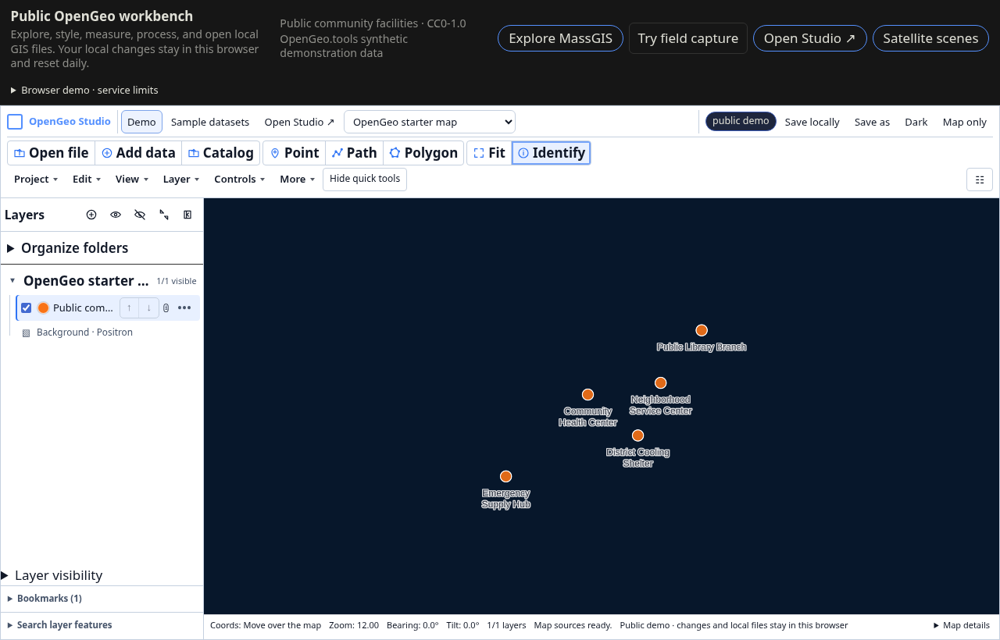
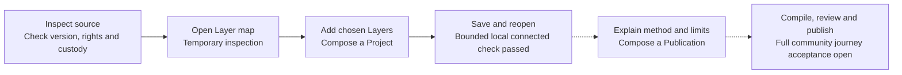

# From a source to an explanation

Which inputs support a map, and what can someone reasonably conclude from it?
OpenGeo Studio connects source inspection, reusable maps and analytical
Publications so that those questions can stay with the work.

Start with the small [community facilities exercise](community-examples.md#try-it-community-facilities).
It uses five invented locations, requires no account and has a downloadable
CC0 input. It introduces the interface without asking you to trust a real-world
screening result.

*Actual application capture from the October 5, 2026 Demo release. The local
capture blocked external basemap requests, so only the five synthetic features
appear. Some display labels predate the current OpenGeo Studio branding. This
image shows the browser Demo; it does not demonstrate account persistence or
publication delivery.*

## Follow the evidence through the workflow

The anonymous Demo provides source review and map composition. Its deployed
starter map and Catalog **Review and add** controls differ from the current
source edition's standalone Catalog Layer preview. **Save locally** stores a
browser draft subject to the Demo's daily reset and storage limits.
Account-backed saving uses Studio and the API. A bounded connected local check
created a Project/map, restarted the database and reopened the saved map; this
does not establish a clean installation or the complete source-to-publication
journey. Those acceptance items remain [on the roadmap](../ROADMAP.md).

| Step | Action and expected result | Evidence to retain |
| --- | --- | --- |
| Inspect | In Studio's Catalog, use **Open map** to inspect the selected Layer by itself before adding it to a Project. In the deployed Demo, use **Catalog → Review and add** to read its source information, then **Cancel** to leave the composition unchanged. | Source address or local input, edition/date, attribution, rights and whether the data is referenced or preserved. Opening a map does not copy a remote source. |
| Compose | Add chosen Layers to a Project, adjust visibility and Style, and choose a useful extent. | Layer identities, selected input versions, Style choices and any transformation parameters. |
| Save and reopen | Save deliberately. In connected Studio, reopen the saved Project/map through the same account and check its Layers and view. In the Demo, use **Save locally** and export a backup. | The persistence destination and the saved revision. A browser draft is separate from an account-backed Project. |
| Explain | In a Publication, state the assessment question, inputs, method and limits; include a map or Project Artifact where appropriate. | The exact source versions, calculations, assumptions and reason for each choice. Publications have their own identity and release history. |
| Review and publish | Preview the output, confirm distribution rights and audience, then use the configured publication path. | The reviewed output and release. A simulated Demo release creates no shared publication; standalone native delivery still needs acceptance. |

The boundary between these steps is useful. A Layer can support several Projects;
inspecting it need not create a Project. A compiled Artifact can be reused by
several Publications. Sharing an explanation does not grant access to restricted
inputs. Keep source-supplied facts separate from your interpretation and identify
which evidence a public reader can actually inspect.

## Choose where to try it

- [Browser Demo](https://demo.studio.opengeo.tools/?map=community-facilities):
  inspect and style the synthetic starter map, with temporary changes on your
  device.
- [Connected local development](community-development.md): follow the supported
  loopback development setup for Studio, API, PostGIS and the worker. The guide
  records the completed save/restart/reopen check and remaining installation
  limits.
- [Hosted Studio](https://studio.opengeo.tools/): use ordinary sign-in and your
  existing resource permissions. Hosted examples do not certify a new installation.
- [Example gallery](community-examples.md): try the small exercise, read published
  work, or contribute a proposed practitioner demonstration.

The [deployment guide](community-deployments.md) explains how the public site,
Studio and the anonymous Demo relate. The [resource model](../ARCHITECTURE_TERMS.md)
defines Layers, Projects, Artifacts and Publications.
