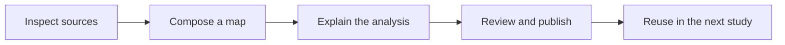

# Build maps you can reuse. Publish analysis others can inspect.

A useful study leaves a foundation for the next one. OpenGeo Studio connects
spatial sources, reusable maps and analytical writing so researchers,
consultants, planners and small teams can return to their inputs and methods
when a question, place or reporting period changes.

The community edition includes the full suite of tools for your own
implementation. The [Demo and managed Studio](community-deployments.md) show
different configurations of that software; their accounts, private connections
and service limits are specific to those deployments.

[Reading beyond the visible](https://opengeo.tools/noaa-coastal-imagery/reading-beyond-visible/)
shows the kind of result this supports: linked NOAA imagery, interactive
comparisons, documented calculations and exportable analysis parameters. The
[example gallery](community-examples.md) includes other published work and a
short exercise for learning the map controls.

## Work through the steps

1. **Inspect the source.** In Studio's Catalog, choose **Open map** to view a
   Layer on its own. Check its coverage, version, attribution and reuse rights.
   Note whether you are referencing remote data or preserving a copy. Inspecting
   a Layer does not create a Project or copy the source.
2. **Compose and save a map.** Reference the Layers you need in a Project,
   choose Styles and set the extent. Keep the Layer identity, selected version
   and processing parameters with any derived data. Reuse the same Layer in a
   second Project when the source is shared; a new map does not require another
   upload of the same managed data.
   Save the Project, then reopen it through the same account to check the
   Layers and view.
3. **Explain the analysis.** Create a Publication with the question, inputs,
   method, findings and limits. Include a map or compiled Project Artifact where
   it helps the reader. A Layer can support several Projects, and an Artifact
   can be reused in several Publications.
4. **Review the output.** Preview the compiled publication, check its maps and
   source references, and confirm that its inputs may be shared with the
   intended audience. Publishing an explanation does not grant access to
   restricted data.
5. **Publish and maintain.** Release the reviewed build to a configured
   destination. Retain the source revision and release identity so you can
   update selected outputs while preserving the earlier edition. A live source
   may change independently; recording its URL does not preserve its bytes.
   Check which versions an output uses before refreshing or rebuilding it. See
   [publication destinations](community-publication-destinations.md) for
   configuration and rollback.

## A recurring study to verify

Use this reference journey to evaluate a community deployment. It is an
acceptance target, not a claim that the complete journey has passed in a fresh
standalone installation.

The maintained starting input is the [five fictional facilities](../app/src/data/sample-public-facilities.geojson),
with [CC0 source information](../app/src/data/public-demo-catalog.json). Four
records have `public_access: true`. Upload it once in a connected installation,
then prepare an inventory map and a clearly labelled accessible-facilities view
using the same Layer. Keep a view filter distinct from a new derived dataset.

| Task | Result to check |
| --- | --- |
| Curate one permitted source | Its Layer has a stable identity, source/version information and explicit reuse terms. |
| Use it in two Projects | Both saved maps reopen with the intended Styles and extent and reference the shared Layer without duplicating its managed data. |
| Organize the study | A Collection references both Projects and the Publication; it grants no additional access to its members. |
| Prepare a publication | Compile and preview the study, review its inputs and publish the approved build. |
| Reuse a map on another website | Exercise the supplied delivery example from a separate origin, including an Observable Framework page. Check access, version choice, attribution and cleanup; embedding and native rendering require separate checks. |
| Make a printable output | Open Print Studio from the map, set the layout and attribution, and inspect the exported figure or print output. |
| Revise the study | Publish the selected update, identify its input revisions and verify that the earlier released edition remains retrievable. |

Distribute the permitted input and rights record, editable Project definitions,
Publication source, static and interactive outputs, external consumer examples,
setup instructions and observed results together. Record actual resource and
release identities, checksums, live dependencies and any local identity or
transport substitutes. Reuse the maintained connected setup and publication
workflow; a manually assembled page or simulated compiler does not prove the
complete journey. An owner/viewer check must include edit denial and revocation.

A complete reference workspace still needs the connected build, authorized
preview, approved public release, revision and external-consumer checks, followed
by reproduction in an independent environment. Existing showcase pages and the
browser exercise illustrate parts of the work; they are not that complete bundle.

Measure time to the first useful output, successful reopening, reuse in a
second study, update effort and colleague handover. Those outcomes establish
the practical value of the workflow. The
[capability guide](community-capabilities.md) and release notes distinguish
implemented components, connected checks and remaining acceptance.

## Choose a workspace

- [Browser Demo](https://demo.studio.opengeo.tools/?map=community-facilities):
  inspect and style the sample map. **Catalog → Review and add** opens source
  information; **Cancel** leaves the composition unchanged. **Project → Save
  on this device** creates a personal Project. The **Saved on this device**
  status identifies the saved revision; **Project → Projects on this device**
  reopens it or downloads a backup. Personal Projects survive sample resets.
- [Connected local development](community-development.md): run Studio with
  the API, PostGIS and worker. The local persistence check covers saving a map,
  restarting the database and reopening it through the same account.
- [Hosted Studio](https://studio.opengeo.tools/): sign in and work within your
  existing resource permissions.

Personal browser Projects stay in that browser profile and origin. They have
no daily expiry, but browser storage can be cleared or evicted; keep a downloaded
backup. Older sample drafts use separate storage with daily expiry. Neither is
an account upload or a public URL, and another website cannot read this browser
storage directly. Export and host a bundle, or deliberately publish a resource,
to use it from another site.

A clean standalone installation and the complete native publishing workflow
still need acceptance; see the [release notes](../RELEASE_NOTES.md). Local
save/reopen evidence or a published example from our deployment does not establish
that complete installation journey.

The [deployment guide](community-deployments.md) explains how Studio, the Demo
and the public site relate. The [resource model](../ARCHITECTURE_TERMS.md)
defines Layers, Projects, Artifacts and Publications.
