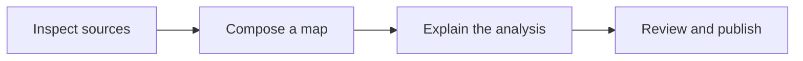

# From source data to a published explanation

A useful map connects a question to its evidence. OpenGeo Studio helps you
inspect sources, compose reusable maps and bring them into a publication with
the methods and context a reader needs.

[Reading beyond the visible](https://opengeo.tools/noaa-coastal-imagery/reading-beyond-visible/)
shows the kind of result this supports: linked NOAA imagery, interactive
comparisons, documented calculations and exportable analysis parameters. The
[example gallery](community-examples.md) includes other published work and a
short exercise for learning the map controls.

## Work through the steps

1. **Inspect the source.** In Studio's Catalog, choose **Open map** to view a
   Layer on its own. Check its coverage, version, attribution and reuse rights.
   Note whether you are referencing remote data or preserving a copy. Inspecting
   a Layer does not create a Project or copy the source.
2. **Compose and save a map.** Add the Layers you need to a Project, choose
   Styles and set the extent. Keep processing parameters with any derived data.
   Save the Project, then reopen it through the same account to check the
   Layers and view.
3. **Explain the analysis.** Create a Publication with the question, inputs,
   method, findings and limits. Include a map or compiled Project Artifact where
   it helps the reader. A Layer can support several Projects, and an Artifact
   can be reused in several Publications.
4. **Review the output.** Preview the compiled publication, check its maps and
   source references, and confirm that its inputs may be shared with the
   intended audience. Publishing an explanation does not grant access to
   restricted data.
5. **Publish and maintain.** Release the reviewed build to a configured
   destination. Retain the source revision and release identity so you can
   update the publication or return to an earlier build. See
   [publication destinations](community-publication-destinations.md) for
   configuration and rollback.

## Choose a workspace

- [Browser Demo](https://demo.studio.opengeo.tools/?map=community-facilities):
  inspect and style the sample map. **Catalog → Review and add** opens source
  information; **Cancel** leaves the composition unchanged. **Save locally**
  stores a draft on your device, subject to the Demo's daily reset. Export work
  you want to keep.
- [Connected local development](community-development.md): run Studio with
  the API, PostGIS and worker. Upload the sample source, add its Layer, change
  color and opacity, and save the map. The maintained browser check verifies that
  the exact map, source identities, data and styling survive a database restart.
  Local sign-in and object/queue transport are synthetic.
- [Hosted Studio](https://studio.opengeo.tools/): sign in and work within your
  existing resource permissions.

The Demo's browser drafts are separate from account-backed Projects. The
[release status](../RELEASE_NOTES.md) records the verified local workflows and
remaining fresh-install and native publishing acceptance.

The [deployment guide](community-deployments.md) explains how Studio, the Demo
and the public site relate. The [resource model](../ARCHITECTURE_TERMS.md)
defines Layers, Projects, Artifacts and Publications.
